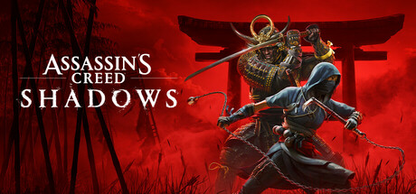

**Assassin's Creed III follows Connor Kenway, half-Mohawk Assassin, through the American Revolutionary War. Features massive wilderness frontiers, naval combat for the first time, and a sweeping story about colonialism and Native American heritage.**

---

## 📖 About

Assassin's Creed III follows Connor Kenway, half-Mohawk Assassin, through the American Revolutionary War. Features massive wilderness frontiers, naval combat for the first time, and a sweeping story about colonialism and Native American heritage.

## ⚠️ Problems Without Trainer

| Problem | Status |
|---------|--------|
| **Slow Opening** — First 6+ hours act as a tutorial before main gameplay opens fully | ✅ Solved |
| **Frontier Navigation** — Wilderness travel without fast travel is extremely time-consuming | ✅ Solved |
| **Homestead Missions** — Building all homestead upgrades requires completing many side activities | ✅ Solved |
| **Connor's Reception** — Protagonist was divisive; lack of charisma made story harder to engage | ✅ Solved |

## ✅ Solution

The **Assassin's Creed III Trainer** solves all these issues by giving you complete control over the game.

## 🎯 Full Feature List

- Unlimited Resources
- God Mode / Invincibility
- Instant Skill Cooldown
- One-Hit Kill
- Freeze Game Timer
- Unlock All Items & Achievements
- Custom Speed Multiplier
- Save State Anywhere

## 🚀 Quick Start

1. **Disable Windows Defender** temporarily (trainer may trigger false positive)
2. Download the trainer from the button above
3. Launch Assassin's Creed III
4. Run the trainer as Administrator
5. Activate desired cheats with hotkeys

## 💎 Free vs Paid

| Feature | Free | Pro |
|---------|------|-----|
| Basic God Mode | ✅ | ✅ |
| Unlimited Resources | ✅ | ✅ |
| All Advanced Cheats | ❌ | ✅ |
| Auto-Updates | ❌ | ✅ |
| Priority Support | ❌ | ✅ |

## 💻 Requirements

- Windows 10/11 (64-bit)
- Assassin's Creed III (any version)
- .NET Framework 4.8+
- DirectX 11+

## 🍎 macOS

macOS users can use our alternative tool:

## ⚖️ Legal

This trainer is for educational and single-player use only. Use responsibly.

---

